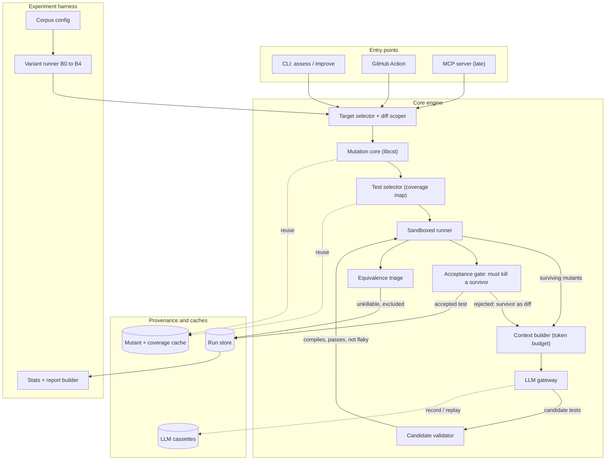

# Architecture

Status: Target architecture. Components are built one stage at a time, so most of this does not exist yet. Source of truth for components, interfaces and data flow. Changes need a PR that also updates the relevant ADR.

## 1. What the system does

Given a repository and optionally a diff, return which seeded faults the existing tests fail to catch, and optionally propose tests that catch them. Every proposed test is accepted only by machine verification.

## 2. The two products

| | The tool | The experiment harness |
|---|---|---|
| Who runs it | A maintainer, on a pull request | You, over a corpus |
| Optimised for | Speed, determinism, no surprises | Reproducibility, provenance |
| Fails when | It is slower than CI patience | A number cannot be regenerated from config |

They share the core engine and nothing else. Keeping them separate is what makes published numbers defensible.

## 3. Diagram



## 4. Package layout (target)

```
mutantlens/
  contracts/      # Pydantic types, added by the task that first needs them. No logic.
  scope/          # target selection, diff scoping
  mutate/         # libcst operators, apply/revert, mutant hashing
  select/         # coverage map, mutant -> tests
  sandbox/        # container execution, limits, outcome classification
  runner/         # orchestration, budgets, caching, parallelism
  llm/            # the ONLY module that imports a provider SDK
  context/        # prompt context strategies (swappable, measured)
  validate/       # candidate test validation
  gate/           # acceptance gate, equivalence triage
  store/          # SQLite run store, cost ledger, parquet export
  report/         # JSON, JUnit, HTML, PR annotations
  cli/
experiment/       # corpus, variants, seeds, statistics - NOT shipped in the package
```

## 5. Principles

1. The verifier is the product. Mutant survival is ground truth, not an opinion.
2. Measure before you generate. The baseline exists before the first prompt.
3. Cost is a first-class metric: score gained per dollar and per minute.
4. Generated code is untrusted code. It runs in a sandbox or it does not run.
5. Boring infrastructure, interesting core. No service to operate, no database to run.
6. Everything reproducible from a config hash plus cassettes.

## 6. The two interfaces to get right first

- **`Mutant`** — file, exact source span, operator, original and replacement text, stable content hash. The hash is what makes caching and cross-run comparison possible.
- **`AssessmentRun`** — the provenance envelope: config hash, tool SHA, target SHA, model snapshot, seeds, budgets, and per-mutant outcomes. If this type is right, every published number is regenerable.
